<div align="center">
  
</div>

<div align="center">

# SD Knowledge · SD 知序

**面向 AI Agent 的本地知识中枢**

集文档解析、混合检索、知识图谱、流式问答与项目工作台于一体的本地优先应用

[English](./README_EN.md) | 简体中文

<p>
  <a href="https://github.com/gqallen931/sd-knowledge/blob/main/LICENSE"></a>
  
  
  
  
  
  
  
</p>

</div>

---

## 目录

- [项目简介](#项目简介)
- [核心亮点](#核心亮点)
- [为什么选择 SD 知序](#为什么选择-sd-知序)
- [功能一览](#功能一览)
- [界面预览](#界面预览)
- [系统架构](#系统架构)
- [核心流程](#核心流程)
- [技术栈](#技术栈)
- [快速开始](#快速开始)
- [安装与配置](#安装与配置)
- [使用指南](#使用指南)
- [运行模式](#运行模式)
- [项目结构](#项目结构)
- [数据模型与迁移](#数据模型与迁移)
- [测试与质量保障](#测试与质量保障)
- [安全与隐私](#安全与隐私)
- [设计文档](#设计文档)
- [路线图](#路线图)
- [贡献指南](#贡献指南)
- [许可证](#许可证)
- [联系方式](#联系方式)

## 项目简介

SD 知序（`sd-knowledge`）是一款**本地优先（Local-First）**的知识管理与智能问答应用。它把散落在本地磁盘的文档解析成**可检索、可溯源**的知识资产，用 **FTS5 全文检索 + 本地向量检索的 RRF 混合排序**给出精准结果，并把命中结果以**分块级引用**的方式交给大模型，生成**可回查出处的流式回答**。

它同时具备三种运行形态——桌面应用、浏览器可访问的 Web 服务、以及供 AI Agent 调用的 MCP Server——三者共享同一套服务层与同一个本地 SQLite 数据库。除知识域外，项目还内置了项目工作台、日程、智能分析与调度大屏，形成「知识 + 任务」的一体化工作空间。

> **默认不联网**：模型接入是插件扩展点且默认关闭，LightRAG 外部引擎桥默认 `disabled`。不配置任何模型时，检索、图谱、工作台等功能完整可用。

## 核心亮点

| 亮点 | 具体实现 | 用户价值 |
| --- | --- | --- |
| **本地优先，零云依赖** | 全部业务数据落在单个本地 SQLite（WAL 模式），无云同步、无遥测 | 资料不出本机，断网可用 |
| **混合检索 + 分块溯源** | FTS5（trigram 分词，原生支持中文子串）与本地向量检索各自排名后按 RRF 融合（`k=60`），再叠加规则重排 | 关键词与语义双路兜底，命中可回查至具体分块与位置锚点 |
| **可验证的 RAG 问答** | 上下文按 `[i]` 编号注入，模型须标注引用；前端点击引用即可跳转原文档分块 | 答案可核验，拒绝「一本正经地编造」 |
| **受控图谱（ADR-007）** | 10 个闭集谓词（`DEPENDS_ON` / `PART_OF` / `USES` / `IMPLEMENTS` / `REPLACES` / `EXTENDS` / `CITES` / `PRODUCES` / `OWNS` / `LOCATED_IN`）+ 句子级关系抽取 + 确定性加权标签传播社区检测 | 关系不再是自由文本噪声，方向与层次可解释 |
| **插件化扩展点（ADR-005 / ADR-006）** | 解析器、嵌入模型、模型 provider 都是插件；内建能力同样走插件路径 | 换协议、换实现不改宿主；停用插件即失效 |
| **出域闸门与审计** | 三档出域范围（当前文档 / 当前作用域 / 整库），整库需二次确认；`llm_egress_logs` 全量留痕 | 发出去的每一段文本都可追溯 |
| **Agent 原生** | 内置 MCP Server，26 个工具覆盖知识域与工作台域 | AI Agent 可直接检索、读写知识库与任务 |

## 为什么选择 SD 知序

| 维度 | SD 知序 | 传统云笔记 / SaaS 知识库 |
| --- | --- | --- |
| 数据归属 | 100% 本地 SQLite，数据完全私有 | 数据托管在第三方云端 |
| AI 能力 | 自带 LLM 网关 + RAG + MCP，可接任意 OpenAI 兼容端点 | 依赖厂商封闭 AI，无法对接自有 Agent |
| 检索质量 | 全文 + 向量 RRF 融合，结果可溯源到分块 | 多为关键词匹配，出处不可核验 |
| 可扩展性 | 四层插件体系，解析器 / 嵌入 / 模型均为扩展点 | 功能封闭，无法扩展 |
| 离线可用 | 完全离线可用，未接模型时自动降级为纯检索 | 断网即不可用 |
| 工作流闭环 | 知识库 + 工作台 + 日程 + 分析 + 大屏 | 通常只覆盖「记笔记」一环 |

## 功能一览

### 知识库与检索
- **多格式解析**：PDF、Word（docx）、Excel、图片（OCR + EXIF）、视频（关键帧抽取），统一分块入库
- **三种检索模式**：全文检索（FTS5）、语义检索（本地向量）、混合检索（RRF 融合）
- **分块级溯源**：每条结果带 `anchor`（页码 / 幻灯片页 / 章节 / 工作表 / 时间戳）
- **文件夹映射**：监听本地目录增量同步，重建目录树并支持跨空间桥接
- **保存检索**：检索条件可命名保存，记录结果哈希与上次运行时间

### 问答与模型接入
- **流式问答**：SSE 增量输出（`/local/ask/stream`、`/api/v1/ask/stream`），支持当前文档 / 当前作用域 / 整库三种提问范围
- **引用回查**：答案中的 `[i]` 直接对应 `chunks`，点击即跳转原文位置
- **诚实降级**：语料不足时明确返回「资料中没有相关内容」，不编造
- **模型即插件**：provider 只能由插件 `createProvider()` 创建，默认没有可用类型；密钥由 AES-256-GCM `KeyVault` 加密存放于主进程
- **LightRAG 桥（可选）**：`lightragBridge.ts` 仅接受 `http://127.0.0.1` 回环地址做只读状态探测，默认关闭，不启动任何外部进程

### 知识图谱
- 实体与关系自动抽取（类型：人物 / 组织 / 术语等），ECharts 交互式渲染
- 图谱筛选（节点类型、数据来源）、跨域桥、语义边
- **实体治理**：重命名、合并、别名管理、合并历史、忽略合并建议
- **社区检测**：按需触发，社区以低权重（`community_affinity`，ζ=0.05）参与检索重排

### 工作台与协作
- 项目 / 任务 / 看板与甘特视图、日程与提醒、智能分析看板
- **账户体系**：本机账户 + 验证码注册 / 找回，`owner` 与 `member` 角色
- **共享与导出**：自包含 JSON 快照（剥离密钥与敏感字段），工作台备份
- **消息中心**与**调度大屏**（Shadow DOM 隔离的 OPS 主题，3s 刷新，卸载时自动清理定时器）

### 资源汇
- GitHub 多领域每日 Star 榜单快照，开源项目卡片式管理，支持手动刷新

## 界面预览

| 知识库概览 | 流式问答 |
| :---: | :---: |
| 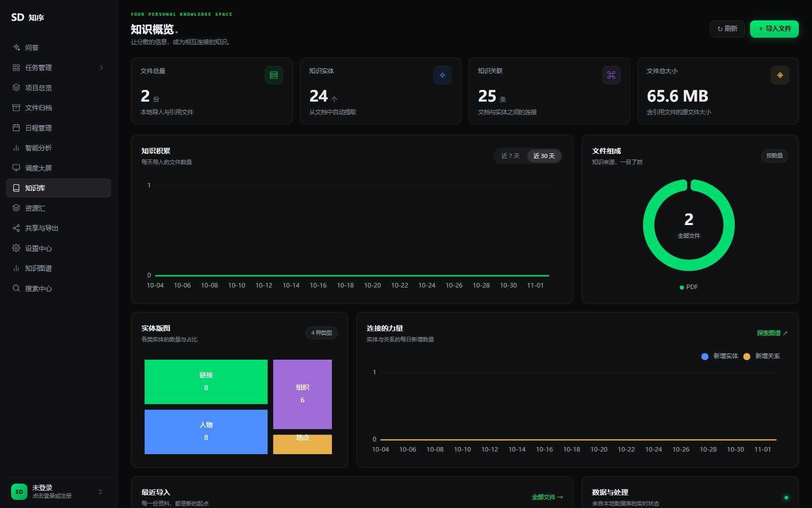 | 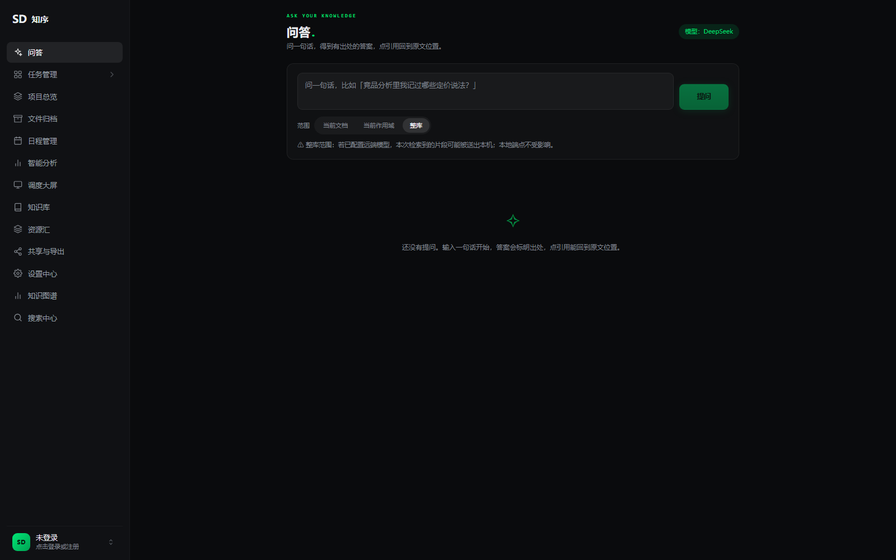 |
| **搜索中心（全文 / 语义 / 混合）** | **文件归档** |
| 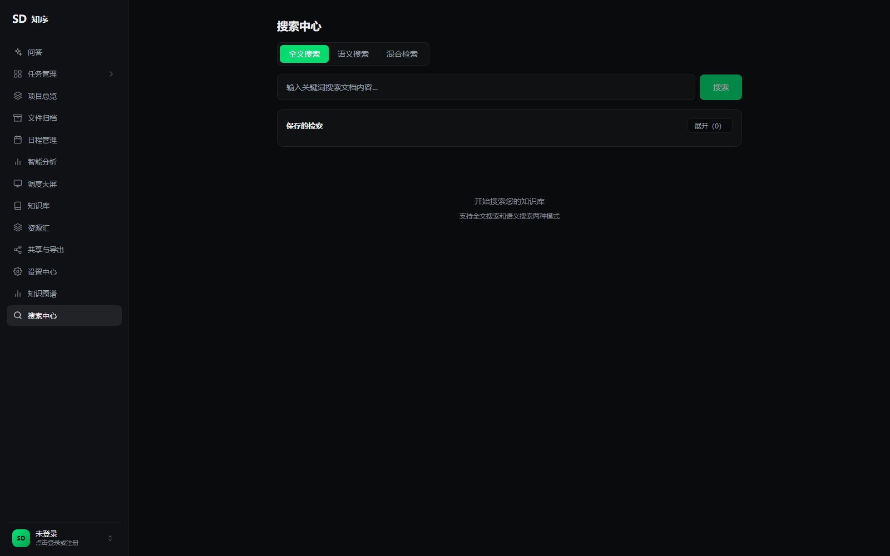 | 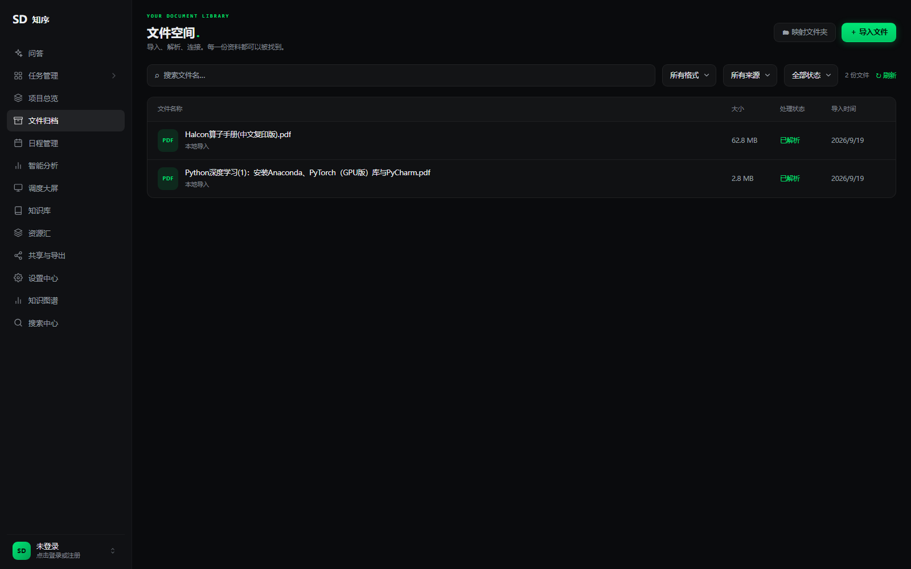 |
| **智能分析** | **资源汇 · GitHub 每日榜单** |
| 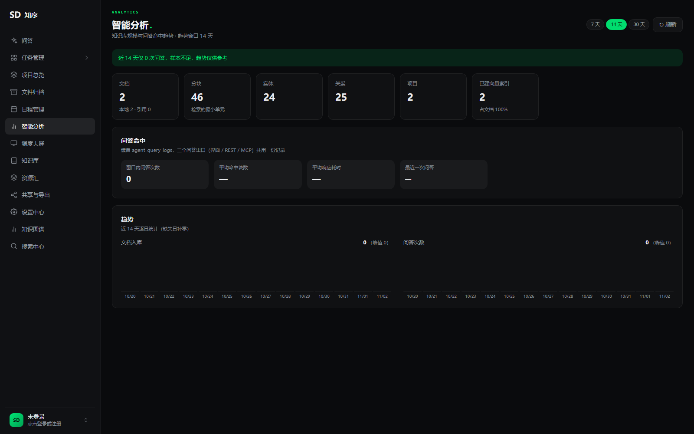 | 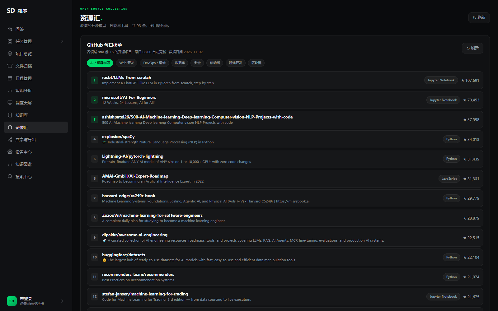 |
| **调度大屏** | **共享与导出** |
| 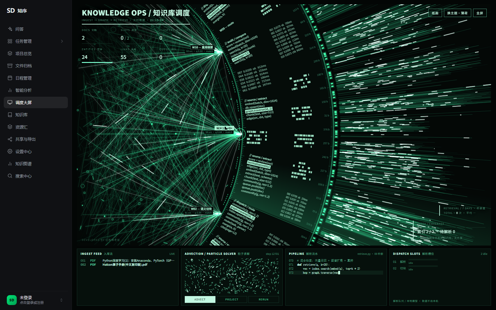 | 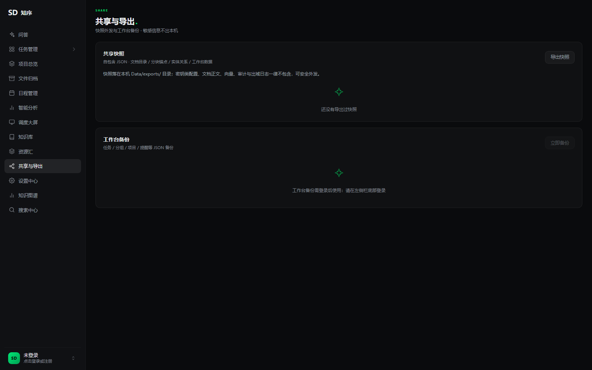 |
| **设置中心** | |
| 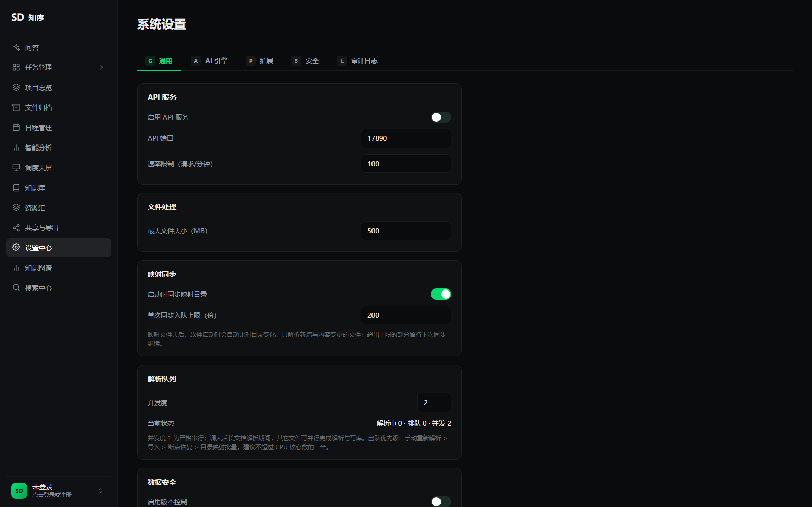 | |

## 系统架构

整体采用「**三形态入口 + 单一服务层 + 单一本地库**」的结构：三种运行形态只是不同的接入方式，业务逻辑全部收敛在 `electron/services/`，因此桌面、Web、MCP 的行为天然一致。

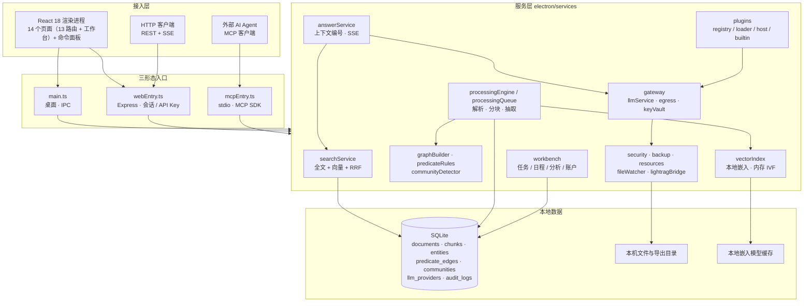

> 说明：模型能力默认不存在于代码路径上——`LlmService` 不再认识任何模型协议，provider 只能由已启用插件的 `createProvider()` 产生；没有配置时网关注册为 `null`，上层按「未接入模型」走纯检索降级。

### 模块划分

| 目录 | 职责 |
| --- | --- |
| `electron/main.ts` | 桌面入口：窗口、IPC、桌面专属能力 |
| `electron/webEntry.ts` | Web 入口：`/local/rpc`（会话鉴权）、`/local/ask/stream`（SSE）、`/api/v1/*`（API Key）、SPA 回退 |
| `electron/mcpEntry.ts` | MCP 入口：stdio 协议，暴露 26 个工具 |
| `electron/services/` | 服务层，三条入口共用：检索、问答、解析、图谱、插件、网关、工作台、安全、备份 |
| `electron/services/plugins/` | 四层插件体系：注册表 / 加载器 / 宿主 / 内建插件 |
| `electron/services/gateway/` | LLM 网关：provider 抽象、出域闸门、密钥库、审计 |
| `electron/services/workbench/` | 工作台域：任务、项目、日程、分析、账户、RPC 分发 |
| `src/pages/` | 页面组件：问答、检索、图谱、文件、资源汇、分析、大屏、共享等（13 个） |
| `src/workbench/` | 工作台 UI 与状态（`WorkbenchContext`） |
| `src/shortcuts.ts` | 全站唯一的数字快捷键注册表，命令面板与键盘监听共用 |
| `tests/` | 集成测试、契约测试与检索评测集 |

### 左侧导航

侧栏共 13 个入口：

```
问答 · 任务管理 · 项目总览 · 文件归档 · 日程管理 · 智能分析 · 调度大屏
知识库 · 资源汇 · 共享与导出 · 设置中心 · 知识图谱 · 搜索中心
```

`Ctrl/Cmd + K` 唤起命令面板；`1`–`9`、`0` 为页面数字快捷键（注册表见 `src/shortcuts.ts`）。

## 核心流程

### 1. 文档入库流水线

从「拖入一个文件」到「可被检索」，中间经过解析、分块、抽取、向量化、建索引五个环节；解析在队列中异步执行，不阻塞界面。

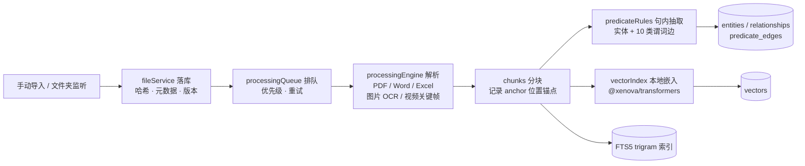

要点：
- 分块与索引**幂等写入**，重复扫描不会产生重复数据；
- 文件夹源使用 `(source_id, path)` 作为目录树自然键，只清理消失项，避免 id 漂移使挂在目录上的边失效；
- 迁移前对存量库自动生成快照（新库跳过）。

### 2. 混合检索与流式问答

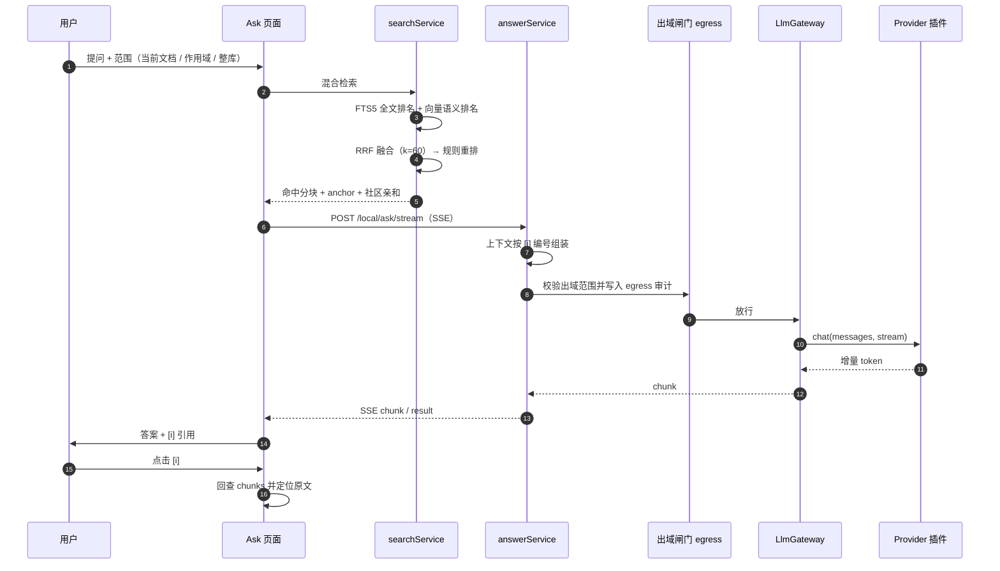

要点：
- 客户端断开时通过 `AbortController` 取消 provider 请求，避免空转与计费；
- 每次问答（成功或失败）都写入 `agent_query_logs`，是智能分析页的数据来源；
- 未配置模型时该入口整体降级，页面不会留下无效入口。

### 3. 知识图谱模型

图谱采用「**受控谓词 + 社区**」而非自由文本关系，避免抽取噪声不可控。

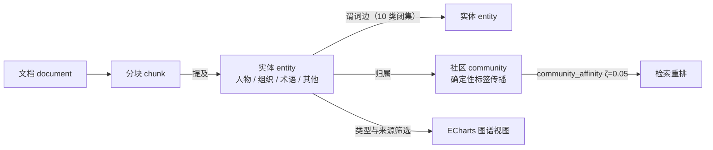

十条谓词构成闭集：`DEPENDS_ON`、`PART_OF`、`USES`、`IMPLEMENTS`、`REPLACES`、`EXTENDS`、`CITES`、`PRODUCES`、`OWNS`、`LOCATED_IN`。抽取规则为**句子级**：同句相邻实体对、窗口不超过 24 字符、跨句不猜；社区检测需显式触发，结果写入 `entity_communities` / `communities`。

### 4. 插件体系分层

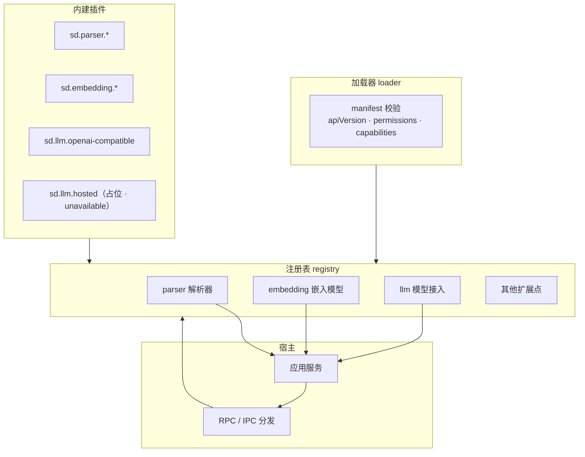

三条不变式：
1. **没有插件就没有 provider**——`buildProvider` 中不存在任何 `new XxxProvider` 字面量；
2. **登记不等于接入**——注册插件只声明能力，不产生配置、不发请求；
3. **停用即失效**——插件停用后其类型从可选清单消失，已保存配置降级为「未接入」，主进程不崩。

## 技术栈

| 层 | 技术选型 |
| --- | --- |
| 桌面壳 | Electron 30（主进程 / 预加载 / 渲染进程隔离） |
| 前端 | React 18.3 · TypeScript 5.4 · Vite 5 · Tailwind CSS · ECharts 5 |
| 后端 | Node.js · Express 4（Web 模式 API） |
| 数据库 | better-sqlite3 11（WAL · FTS5 trigram · 版本化迁移） |
| 检索 | FTS5 全文 + `@xenova/transformers` 本地向量（内存 IVF）+ RRF 融合 |
| NLP | nodejieba（中文分词）· compromise（英文） |
| 文档解析 | pdfjs-dist · mammoth · xlsx / exceljs · tesseract.js · exifr · fluent-ffmpeg |
| 安全 | AES-256-GCM 密钥库 · API Key 鉴权 · 审计日志 |
| Agent 接入 | @modelcontextprotocol/sdk 1.x |

## 快速开始

### 环境要求

- Node.js ≥ 18（推荐 20 LTS）
- Windows 10/11（当前主要支持平台，macOS / Linux 适配见[路线图](#路线图)）
- 可选：FFmpeg（视频关键帧抽取需要）

### 三分钟跑起来

```bash
# 1. 克隆仓库
git clone https://github.com/gqallen931/sd-knowledge.git
cd sd-knowledge

# 2. 安装依赖并重建原生模块（better-sqlite3 需与 Electron ABI 对齐）
npm install
npm run rebuild

# 3. 启动开发环境（Vite 热更新 + Electron）
npm run dev
```

启动后：在**文件归档**中导入文档（或添加文件夹源），等待解析完成后即可在**搜索中心**检索；**知识库概览**会同步刷新文档、实体、关系与体积统计。

### 常用脚本

| 命令 | 作用 |
| --- | --- |
| `npm run dev` | 开发模式：Vite + Electron |
| `npm run build` | 类型检查 + 前端构建 |
| `npm run package:win` | 打包 Windows 安装包（输出至 `release/`） |
| `npm run start:web` | 以 Web 形态启动（需先 `npm run build`） |
| `npm run dev:web` | Web 形态开发（API 端口 5174） |
| `npm run mcp` | 以 MCP Server 形态启动 |
| `npm test` | 类型检查 + 13 个集成/契约测试 |
| `npm run eval` | 检索评测，比对基线 |
| `npm run perf:report` | 性能报告 |

## 安装与配置

### 模型接入（可选，默认关闭）

模型接入是**插件扩展点**，默认没有任何可用 provider 类型。启用步骤：

1. 在「设置中心 → 扩展」中启用以模型接入插件（如内建 `sd.llm.openai-compatible`）；
2. 在「设置中心 → AI 引擎」中新增一条 provider 配置。

| 配置项 | 示例 | 说明 |
| --- | --- | --- |
| 类型 | `byo-openai` | 取值来自**已启用插件**的声明，插件停用即消失 |
| API Endpoint | `https://api.deepseek.com/v1` | OpenAI 兼容接口地址 |
| API Key | `sk-...` | AES-256-GCM 加密后存于主进程，渲染进程不可见 |
| Model | `deepseek-chat` | 模型标识 |
| 出域范围 | 当前文档 / 当前作用域 / 整库 | 默认最小档；整库需二次确认并写入风险提示 |

> 未配置模型时不会产生任何外发请求（这条约束有测试守护：`tests/llm-plugin-seam.cjs` 用看门狗端点断言「零请求」）。

### LightRAG 桥（可选，默认关闭）

`lightragBridge.ts` 仅作为**连接器**存在，相关设置项与默认值如下：

```
lightrag_enabled  = false（默认）
lightrag_endpoint = http://127.0.0.1:9621（只允许 http 回环根地址）
lightrag_timeout_ms = 5000
```

状态取值 `disabled` / `ready` / `unavailable` / `misconfigured`；桥不启动、不管理任何外部进程，只做只读状态探测。端点若带 userinfo、路径、查询串或非回环主机，直接判为 `misconfigured`。

### 数据位置

- 业务库：单个本地 SQLite 文件（应用数据目录，WAL 模式）
- 共享快照：`Data/exports/`（自包含 JSON，剥离密钥与敏感字段）
- 嵌入模型：首次使用时下载并缓存于本地模型目录

## 使用指南

<details>
<summary><b>流程 1：导入文档并建立索引</b></summary>

1. 进入**文件归档**，点击「导入文件」或「映射文件夹」；
2. 解析任务进入队列，队列并发度可在「设置中心 → 通用 → 解析队列」调整（1–32，默认 2）；
3. 解析完成后进入**搜索中心**，切换「全文检索 / 语义检索 / 混合检索」三种模式验证结果；
4. 在**知识库概览**查看文档总量、知识实体、知识关联与文件体积的变化。
</details>

<details>
<summary><b>流程 2：提问并获得带引用的答案</b></summary>

1. 进入**问答**，输入问题并选择范围（当前文档 / 当前作用域 / 整库）；
2. 系统先执行混合检索，再把命中分块按 `[i]` 编号交给模型流式生成；
3. 答案中的每个引用编号都可点击回查原文分块；
4. 语料不足时返回「资料中没有相关内容」，不做臆测。
</details>

<details>
<summary><b>流程 3：治理知识图谱</b></summary>

1. 进入**知识图谱**，在「图谱筛选」中按节点类型（文档 / 实体 / 术语）与数据来源（本地导入 / 外部引用）过滤；
2. 点击空间节点下钻到该空间的实体层；
3. 使用「力导向 / 环形」切换布局，通过「批量合并」「构建建议」处理同义实体；
4. 实体重命名与合并会写入别名与合并历史，可在图谱面板回看。
</details>

<details>
<summary><b>流程 4：通过 MCP 让 AI Agent 接入</b></summary>

```bash
# 以 MCP Server 形态启动（先完成构建）
npm run mcp
```

在支持 MCP 的客户端中注册该 Server 后，Agent 可调用 26 个工具：知识域 15 个（`search`、`semantic_search`、`get_context`、`ask`、`list_documents`、`get_document`、`get_graph_stats`、`get_entities`、`get_entity_graph`、`find_connections`、`search_entities`、`rename_entity`、`merge_entities` 等），工作台域 11 个（`workbench_overview`、`list_tasks`、`create_task`、`update_task`、`complete_task`、`get_timeline`、`search_all` 等）。
</details>

<details>
<summary><b>流程 5：导出可外发的共享快照</b></summary>

1. 进入**共享与导出**，点击「导出快照」；
2. 生成的自包含 JSON 只包含文档、分块、实体关系、工作台数据；
3. **密钥、明文敏感字段、向量、审计与出域日志一律不包含**，可安全外发。
</details>

## 运行模式

| 模式 | 命令 | 鉴权方式 | 适用场景 |
| --- | --- | --- | --- |
| 桌面 | `npm run dev` / `npm run start:desktop` | 本机进程内 IPC | 单机完整形态，全部能力可用 |
| Web | `npm run dev:web` / `npm run start:web` | `/local/*` 走会话（`X-SD-Session`）；`/api/v1/*` 走 API Key | 局域网内多设备访问、脚本调用 |
| MCP | `npm run mcp` | 进程级 stdio | 供外部 AI Agent 接入知识库与工作台 |

## 项目结构

```
sd-knowledge/
├── electron/                    # 主进程
│   ├── main.ts                  # 桌面模式入口（IPC）
│   ├── webEntry.ts              # Web 模式入口（Express / SSE / API Key）
│   ├── mcpEntry.ts              # MCP Server 入口（stdio）
│   └── services/                # 服务层（三条入口共用）
│       ├── database.ts          # SQLite 连接、索引、FTS5、默认设置
│       ├── coreMigrations.ts    # 版本化迁移 v1–v9
│       ├── searchService.ts     # 全文 / 语义 / RRF 混合检索
│       ├── answerService.ts     # 上下文编号、流式问答、引用
│       ├── processingEngine.ts  # 解析流水线
│       ├── processingQueue.ts   # 解析队列（并发、重试、优先级）
│       ├── vectorIndex.ts       # 本地向量索引（内存 IVF）
│       ├── graphBuilder.ts      # 图谱构建与实体治理
│       ├── predicateRules.ts    # 10 类受控谓词抽取规则
│       ├── communityDetector.ts # 确定性标签传播社区检测
│       ├── lightragBridge.ts    # LightRAG 只读连接器（默认关闭）
│       ├── mcpServer.ts         # 26 个 MCP 工具
│       ├── gateway/             # LLM 网关：provider / egress / keyVault
│       ├── plugins/             # 插件体系：registry / loader / host / builtin
│       └── workbench/           # 任务、项目、日程、分析、账户
├── src/                         # 渲染进程（React）
│   ├── pages/                   # 13 个页面组件
│   ├── workbench/               # 工作台 UI 与状态
│   ├── components/              # 侧栏、命令面板等
│   └── shortcuts.ts             # 快捷键注册表
├── tests/                       # 集成 / 契约测试 + 检索评测集（eval/）
├── docs/assets/                 # README 截图与架构图
└── resources/                   # 图标与打包资源
```

## 数据模型与迁移

所有结构变更走**版本化迁移**（`coreMigrations.ts` + `workbench/schema.ts`），存量库在迁移前自动快照。

| 版本 | 迁移 | 关键内容 |
| --- | --- | --- |
| v1 | `baseline-document-and-queue-columns` | 文档与队列表字段基线 |
| v2 | `chunks-and-vector-chunk-link` | `chunks` 分块表、向量与分块关联 |
| v3 | `llm-providers-and-egress-logs` | `llm_providers`、`llm_egress_logs` |
| v4 | `llm-egress-scope-and-host-columns` | 出域范围档位与目标 host |
| v5 | `resources-open-source-hub` | 资源汇开源项目 |
| v6 | `github-daily-rank` | GitHub 每日榜单快照 |
| v7 | `saved-searches` | 保存检索（结果哈希、上次运行） |
| v8 | `entity-aliases-and-merge-history` | 实体别名、合并历史、忽略记录 |
| v9 | `predicate-edges-and-entity-communities` | 谓词边、实体社区、社区统计 |

## 测试与质量保障

`npm test` 先做双端类型检查（渲染进程 + 主进程），再依次运行 13 个测试脚本：

| 测试 | 覆盖点 |
| --- | --- |
| `lightrag-bridge.cjs` | 端点归一化、`disabled` 默认态、非回环拒绝 |
| `llm-gateway.cjs` | provider 生命周期、错误分级、出域闸门 |
| `llm-plugin-seam.cjs` | 模型接入插件缝：零请求断言、停用降级 |
| `integration.cjs` | 端到端：导入 → 解析 → 检索 → 图谱 |
| `predicate-graph.cjs` | 10 类谓词抽取与社区检测 |
| `auth-flow.cjs` / `auth-web.cjs` | 账户注册 / 登录 / 会话与 Web 鉴权 |
| `saved-search.cjs` / `entity-alias.cjs` | 保存检索、实体别名与合并 |
| `analytics-logs.cjs` / `audit-retention.cjs` | 分析聚合口径、审计保留与清理 |
| `schedule.cjs` / `export-snapshot.cjs` | 日程计算、共享快照字段剥离 |

此外：

- `npm run eval`：检索评测集，输出与基线的差异，防止检索质量回退；
- `npm run perf:report` / `npm run perf:threads`：检索与向量化性能报告。

## 安全与隐私

- **本地优先**：业务数据只落本地 SQLite，无云同步、无遥测；
- **密钥隔离**：模型 Key 由 AES-256-GCM 加密后仅存主进程，渲染进程零暴露；
- **出域闸门**：三档出域范围，整库出域需显式二次确认，每次出域写审计日志（时间 / provider / host / 档位 / 块数与字符数 / 文档与块 id）；
- **鉴权分层**：Web 侧 `/local/*` 需会话，`/api/v1/*` 需 API Key（按角色与 scopes 授权）；
- **审计可清理**：审计保留天数可配置，支持按策略裁剪；
- **故障隔离**：插件加载或运行失败只影响插件自身，宿主零影响；
- **错误分级**：接口统一错误码，不向外部泄露 SQL 语句与绝对路径。

## 设计文档

关键架构决策均有 ADR 记录（随工作区文档库维护）：

| 文档 | 内容 |
| --- | --- |
| ADR-001 | FTS5 trigram 中文全文检索方案 |
| ADR-002 | 作用域图谱与日闭环设计 |
| ADR-003 | DeskForge 融合方案 |
| ADR-004 | LLM 接入策略与密钥隔离 |
| ADR-005 | 插件化架构（注册表 / 加载器 / 宿主 / 内建插件） |
| ADR-006 | 模型接入下沉为插件扩展点（默认关闭） |
| ADR-007 | 受控谓词图谱与社区检测 |

## 路线图

- [x] **S0 · 本地底座** — 多格式解析流水线 · FTS5 + 向量 RRF 混合检索 · 分块溯源 · 文件夹映射
- [x] **S1 · 问答闭环** — LLM 网关 · 出域闸门与审计 · SSE 流式问答 · 引用回查 · 检索评测基线
- [x] **S2 · 平台化** — 插件体系 · 账户体系 · 工作台 / 日程 / 智能分析 · 消息与共享导出 · 调度大屏 · 保存检索 · 实体别名与合并
- [x] **图谱深化** — 受控谓词边 · 句子级关系抽取 · 确定性社区检测（迁移 v9）· 模型接入插件化（ADR-006）
- [ ] **打包与分发** — Windows 安装包签名与自动更新（`S2-11`）
- [ ] **跨平台** — macOS / Linux 构建与适配
- [ ] **更多扩展点** — 新增解析器 / 嵌入模型插件 · LightRAG 外部引擎按需接入 · 设计文档全量开源

## 贡献指南

欢迎提交 Issue 与 Pull Request。提交 PR 前请确保：

1. `npm run typecheck` 通过（渲染进程与主进程双端类型检查）
2. `npm test` 全部通过
3. 涉及检索或排序逻辑的变更，运行 `npm run eval` 确认无基线回归
4. 涉及数据库结构的变更，新增迁移而不是改旧迁移，并同步测试
5. 提交信息遵循约定式提交（`feat:` / `fix:` / `docs:` / `refactor:` / `test:`）

## 许可证

本项目基于 [MIT License](./LICENSE) 开源，可自由用于个人与商业用途。

## 联系方式

- **Issue 反馈**：[GitHub Issues](https://github.com/gqallen931/sd-knowledge/issues)
- **讨论交流**：[GitHub Discussions](https://github.com/gqallen931/sd-knowledge/discussions)

---

<div align="center">

如果这个项目对你有帮助，欢迎点个 ⭐ Star 支持一下

</div>
