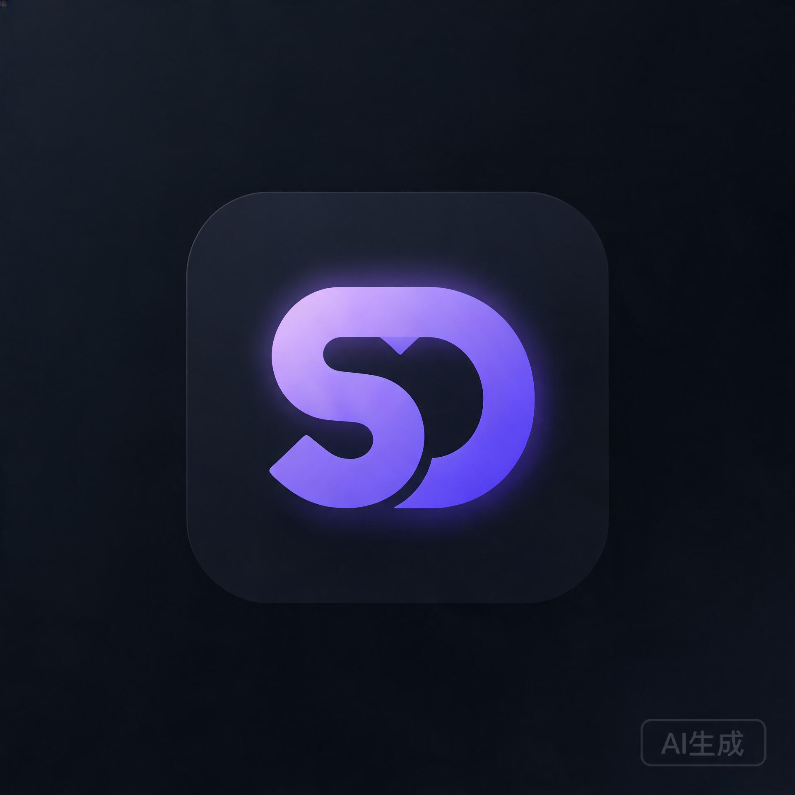
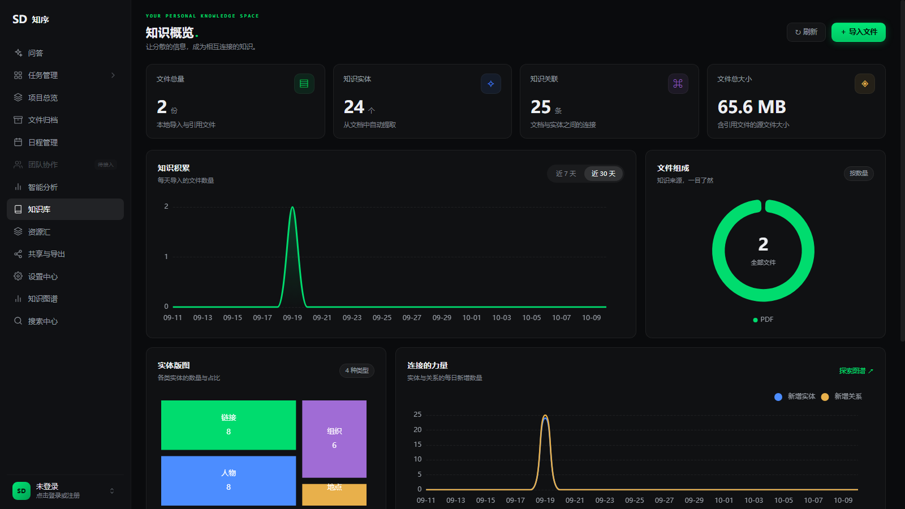
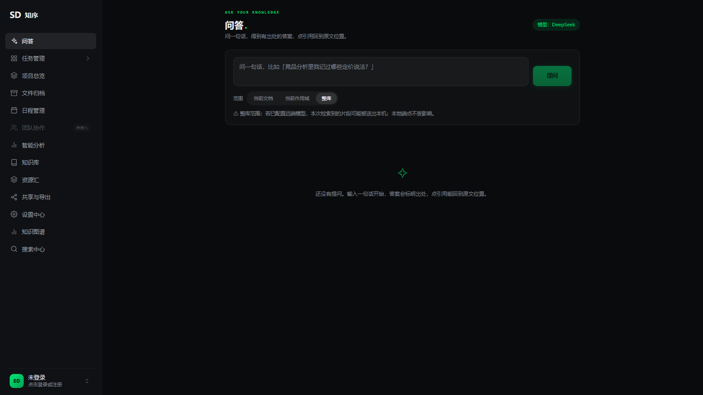
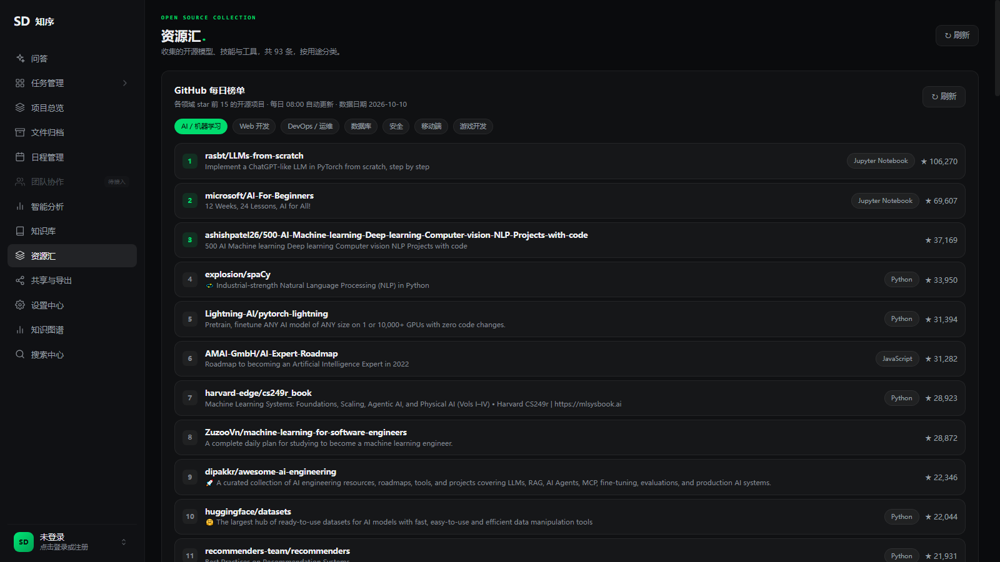
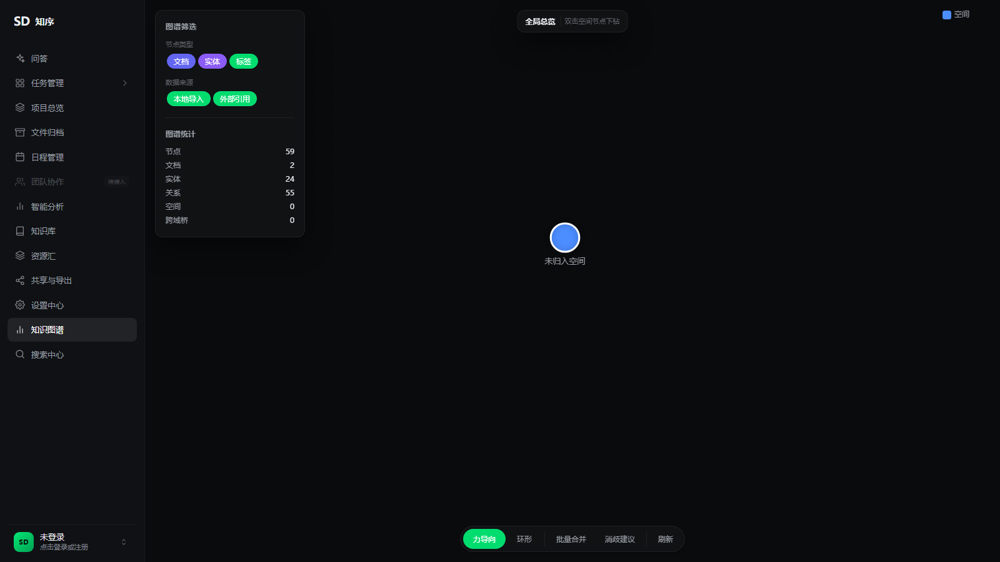
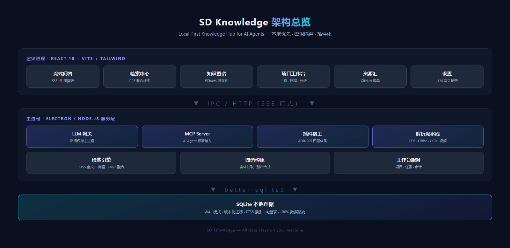

<div align="center">
  
</div>

<div align="center">

# SD Knowledge

**A Local-First Knowledge Hub for AI Agents**

An all-in-one local-first desktop app combining knowledge base, knowledge graph, hybrid search, streaming Q&A, and a project workbench

English | [简体中文](./README.md)

<p>
  <a href="https://github.com/gqallen931/sd-knowledge/blob/main/LICENSE"></a>
  
  
  
  
  
  
</p>

</div>

---

## Table of Contents

- [Introduction](#introduction)
- [Why SD Knowledge](#why-sd-knowledge)
- [Demo](#demo)
- [Key Features](#key-features)
- [Architecture](#architecture)
- [Quick Start](#quick-start)
- [Installation & Configuration](#installation--configuration)
- [Usage Examples](#usage-examples)
- [Run Modes](#run-modes)
- [Project Structure](#project-structure)
- [Documentation](#documentation)
- [Security & Privacy](#security--privacy)
- [Roadmap](#roadmap)
- [Contributing](#contributing)
- [License](#license)
- [Contact](#contact)

## Introduction

SD Knowledge is a **local-first** knowledge management and intelligent Q&A platform. It parses your scattered local documents into retrievable, traceable knowledge assets, delivers precise search through **RRF hybrid ranking over FTS5 full-text + vector search**, and plugs into any OpenAI-compatible LLM for **streaming Q&A with verifiable citations**.

With a built-in **MCP Server**, AI agents can search, read, and write your knowledge base through a standard protocol — SD Knowledge is not just a knowledge base for humans, but a knowledge foundation for AI agents.

## Why SD Knowledge

| Dimension | SD Knowledge | Traditional Cloud Notes / SaaS KB |
| --- | --- | --- |
| Data ownership | 100% local SQLite, fully private | Hosted on third-party cloud |
| AI capability | Built-in LLM gateway + RAG + MCP protocol | Vendor-locked AI, no agent integration |
| Search quality | Hybrid full-text + vector RRF with chunk-level traceability | Keyword matching, unverifiable answers |
| Extensibility | Plugin architecture (ADR-005); built-ins are plugins | Closed feature set |
| Offline | Fully functional offline; degrades gracefully without LLM | Useless without connectivity |

## Demo

<!-- DEMO VIDEO: uncomment after recording; host the video as a Release attachment or on Bilibili/YouTube
<div align="center">
  <a href="https://github.com/gqallen931/sd-knowledge/releases/download/demo/demo.mp4">
    
  </a>
  <p><em>Click to watch the full demo video (2 min)</em></p>
</div>
-->

| Knowledge Dashboard | Streaming Q&A (DeepSeek) |
| :---: | :---: |
|  |  |
| **Resource Hub · Daily GitHub Trending** | **Knowledge Graph** |
|  |  |

## Key Features

### 📚 Knowledge Base & Hybrid Search
- **Multi-format parsing**: PDF, Word, Excel, images (OCR + EXIF), video (keyframe extraction) — all chunked and indexed uniformly
- **RRF hybrid search**: FTS5 full-text (trigram tokenizer, native CJK support) fused with local vector search via Reciprocal Rank Fusion
- **Chunk-level traceability**: every result traces back to the exact chunk and position anchor (page / timestamp) in the source document
- **Folder mapping**: watch local directories with incremental indexing, folder trees, and cross-project bridges

### 🤖 AI Q&A & Agent Integration
- **Streaming Q&A**: SSE-based streaming with a live citation panel; gracefully degrades to a pure search page when no LLM is configured
- **LLM gateway**: works with any OpenAI-compatible endpoint (DeepSeek, etc.); API keys stay in the main process, never exposed to the renderer
- **MCP Server**: built-in Model Context Protocol server so AI agents can search, read, and write the knowledge base
- **Measurable quality**: built-in retrieval evaluation suite with baseline regression (`npm run eval`)

### 🕸️ Knowledge Graph
- Automatic entity & relation extraction from documents into an interactive graph (ECharts)
- Graph editing, entity merge suggestions, alias management, and merge history auditing

### 📊 Project Workbench
- Projects, task groups, Gantt charts, calendar, and analytics dashboards
- Resource hub: daily GitHub trending snapshots across domains, card-style open-source project management

### 🧩 Plugin Architecture
- Four-layer plugin system per ADR-005: Registry / Loader / Host / Built-in plugins
- **Dogfooding principle**: all built-in features are implemented through the plugin path
- Plugins declare `apiVersion` and permissions via `manifest.json`; load failures are isolated without affecting the host

## Architecture



| Layer | Stack |
| --- | --- |
| Desktop shell | Electron 30 (main / preload / renderer isolation) |
| Frontend | React 18 · TypeScript · Vite · Tailwind CSS · ECharts |
| Backend | Node.js · Express (Web-mode API) |
| Database | better-sqlite3 (FTS5 · WAL · versioned migrations) |
| AI / NLP | @xenova/transformers (local embeddings) · nodejieba · compromise |
| Document parsing | pdfjs-dist · mammoth · xlsx/exceljs · tesseract.js · fluent-ffmpeg |
| Agent integration | @modelcontextprotocol/sdk |

## Quick Start

### Prerequisites

- Node.js ≥ 18
- Windows 10/11 (primary platform; macOS / Linux support on the [roadmap](#roadmap))

### Up and running in 3 minutes

```bash
# 1. Clone the repository
git clone https://github.com/gqallen931/sd-knowledge.git
cd sd-knowledge

# 2. Install dependencies and rebuild native modules (better-sqlite3)
npm install
npm run rebuild

# 3. Start the dev environment (Vite HMR + Electron)
npm run dev
```

Create a project, drop in documents, and once parsing completes you can search in the Search Center. Configure an LLM (see below) to enable streaming Q&A.

## Installation & Configuration

### Production build

```bash
# Build and package the Windows installer (output to release/)
npm run package:win
```

### LLM configuration (optional)

Configure any OpenAI-compatible endpoint under **Settings → LLM Gateway**:

| Field | Example | Notes |
| --- | --- | --- |
| API Endpoint | `https://api.deepseek.com/v1` | OpenAI-compatible API base URL |
| API Key | `sk-...` | Stored in the main process only; never uploaded or exposed to the renderer |
| Model | `deepseek-chat` | Model identifier |

> Without an LLM configured, the Ask page automatically degrades to a search page — all core retrieval capabilities remain available.

## Usage Examples

<details>
<summary><b>Example 1: Streaming Q&A with citations</b></summary>

Ask a question on the Ask page. The system runs hybrid retrieval first, then streams an LLM answer grounded in the retrieved chunks, with citation markers on every claim. Clicking a citation jumps to the exact chunk in the source document. When local knowledge cannot support an answer, the system honestly responds "no relevant content found" instead of hallucinating.
</details>

<details>
<summary><b>Example 2: Connect AI agents via MCP</b></summary>

```bash
# Start as an MCP Server
npm run mcp
```

Register the server in any MCP-capable agent (e.g., Claude Desktop), and the agent can invoke standard tools to search, read, and write your knowledge base directly.
</details>

<details>
<summary><b>Example 3: Auto-indexing via folder mapping</b></summary>

Add a local directory (e.g., `D:\Documents\ProjectFiles`) under **File Manager → Folder Sources**. The app watches for changes and automatically parses, chunks, and indexes new or modified documents — no manual import needed.
</details>

## Run Modes

| Mode | Command | Use case |
| --- | --- | --- |
| Desktop | `npm run dev` / `npm run start:desktop` | Full Electron experience with all capabilities |
| Web | `npm run dev:web` | Browser access, suitable for LAN multi-device sharing |
| MCP | `npm run mcp` | Runs as an MCP Server for external AI agents |

## Project Structure

```
sd-knowledge/
├── electron/                  # Main process
│   ├── main.ts                # Desktop entry
│   ├── webEntry.ts            # Web-mode entry
│   ├── mcpEntry.ts            # MCP Server entry
│   └── services/              # Core services
│       ├── database.ts        # SQLite connection & versioned migrations
│       ├── searchService.ts   # RRF hybrid search
│       ├── answerService.ts   # Streaming Q&A with citations
│       ├── graphBuilder.ts    # Knowledge graph construction
│       ├── processingEngine.ts# Document parsing pipeline
│       ├── vectorIndex.ts     # Local vector index
│       ├── mcpServer.ts       # MCP protocol server
│       ├── gateway/           # LLM gateway (key isolation)
│       ├── plugins/           # Plugin system (registry/loader/host)
│       └── workbench/         # Workbench services
├── src/                       # Renderer (React)
│   ├── pages/                 # Ask / Search / Graph / Files / Resources / Settings
│   └── workbench/             # Workbench UI
├── tests/                     # Integration tests & retrieval evaluation
└── resources/                 # Icons and packaging assets
```

## Documentation

The project maintains a complete design documentation system with ADRs for key architectural decisions:

| Document | Topic |
| --- | --- |
| ADR-001 | FTS5 trigram full-text search for Chinese |
| ADR-002 | Scoped graph and daily loop design |
| ADR-004 | LLM access strategy and key isolation |
| ADR-005 | Plugin architecture (registry / loader / host / built-ins) |

> Full design docs (feature specs, bug postmortems, product plans) are maintained in a private documentation repository and will be migrated into `docs/` progressively.

## Security & Privacy

- **Local-first**: all business data lives in local SQLite — zero cloud sync
- **Key isolation**: LLM API keys are stored in the main process only, inaccessible to the renderer
- **Graded errors**: backend APIs use unified error grading; no SQL or file path leakage
- **Egress gate**: every outbound request (LLM calls, GitHub API) has an explicit switch and audit log
- **Fault isolation**: plugin load failures are contained; the host application is never affected

## Roadmap

- [x] **S0** — Document parsing pipeline · RRF hybrid search · chunk traceability
- [x] **S1** — LLM gateway · streaming Q&A · citation tracing
- [x] **S2** — Plugin architecture · entity aliases · audit retention · calendar/analytics aggregation
- [ ] **S3** — Scheduled daily trending updates · more LLM providers · local model support
- [ ] **S4** — macOS / Linux packaging · full open-sourcing of design docs

## Contributing

Issues and Pull Requests are welcome. Before submitting a PR, please ensure:

1. `npm run typecheck` passes
2. `npm test` (integration tests) passes
3. For retrieval-related changes, run `npm run eval` to confirm no baseline regression
4. Commit messages follow Conventional Commits (e.g., `feat:` / `fix:` / `docs:`)

## License

Released under the [MIT License](./LICENSE) — free for personal and commercial use.

## Contact

- **Bug reports & feature requests**: [GitHub Issues](https://github.com/gqallen931/sd-knowledge/issues)
- **Discussions**: [GitHub Discussions](https://github.com/gqallen931/sd-knowledge/discussions)

---

<div align="center">

If this project helps you, please consider giving it a ⭐ Star

</div>
