<div align="center">
  
</div>

<div align="center">

# SD Knowledge

**A Local-First Knowledge Hub for AI Agents**

Document parsing, hybrid retrieval, knowledge graph, streaming Q&A and a project workbench in one local-first app

English | [简体中文](./README.md)

<p>
  <a href="https://github.com/gqallen931/sd-knowledge/blob/main/LICENSE"></a>
  
  
  
  
  
  
  
</p>

</div>

---

## Table of Contents

- [Introduction](#introduction)
- [Highlights](#highlights)
- [Why SD Knowledge](#why-sd-knowledge)
- [Features](#features)
- [Screenshots](#screenshots)
- [Architecture](#architecture)
- [Core Flows](#core-flows)
- [Tech Stack](#tech-stack)
- [Quick Start](#quick-start)
- [Installation & Configuration](#installation--configuration)
- [Usage Guide](#usage-guide)
- [Run Modes](#run-modes)
- [Project Structure](#project-structure)
- [Data Model & Migrations](#data-model--migrations)
- [Testing & Quality](#testing--quality)
- [Security & Privacy](#security--privacy)
- [Design Docs](#design-docs)
- [Roadmap](#roadmap)
- [Contributing](#contributing)
- [License](#license)
- [Contact](#contact)

## Introduction

SD Knowledge is a **local-first** knowledge management and Q&A application. It parses documents scattered across your local disk into **retrievable, traceable** knowledge assets, ranks results with **RRF fusion of FTS5 full-text and local vector search**, and feeds the retrieved chunks to an LLM as **numbered citations** to produce **streaming answers you can verify against the source**.

It runs in three forms — desktop app, browser-accessible web service, and an MCP Server for AI agents — all sharing the same service layer and the same local SQLite database. Beyond knowledge, the app ships a project workbench, calendar, analytics and an operations big-screen, forming a single workspace for "knowledge + tasks".

> **Offline by default**: model access is a plugin extension point that is disabled by default, and the LightRAG bridge defaults to `disabled`. Without any model configured, retrieval, graph and workbench remain fully functional.

## Highlights

| Highlight | Implementation | Value |
| --- | --- | --- |
| **Local-first, zero cloud** | All business data in a single local SQLite file (WAL); no cloud sync, no telemetry | Your documents never leave the machine |
| **Hybrid retrieval + chunk tracing** | FTS5 (trigram tokenizer, native CJK substring search) and local vector search are ranked separately and fused with RRF (`k=60`), then re-ranked by rules | Both keyword and semantic recall; every hit traces back to a chunk and position anchor |
| **Verifiable RAG** | Context injected with `[i]` markers; the model must cite; clicking a citation jumps to the source chunk | Answers stay checkable — no confident fabrication |
| **Governed graph (ADR-007)** | 10 closed-set predicates (`DEPENDS_ON` / `PART_OF` / `USES` / `IMPLEMENTS` / `REPLACES` / `EXTENDS` / `CITES` / `PRODUCES` / `OWNS` / `LOCATED_IN`) + sentence-level extraction + deterministic weighted label-propagation community detection | Relations are explainable, not free-text noise |
| **Plugin extension points (ADR-005 / ADR-006)** | Parsers, embedding models and model providers are plugins; built-ins use the same path | Swap protocols or implementations without touching the host |
| **Egress gate & audit** | Three egress scopes (current document / selected scope / whole library); whole-library requires explicit confirmation; every call logged in `llm_egress_logs` | Every piece of text that leaves the machine is traceable |
| **Agent-native** | Built-in MCP Server exposing 26 tools across knowledge and workbench domains | Agents can search and write your knowledge base directly |

## Why SD Knowledge

| Dimension | SD Knowledge | Typical cloud notes / SaaS KB |
| --- | --- | --- |
| Data ownership | 100% local SQLite, fully private | Hosted on third-party cloud |
| AI capability | Built-in LLM gateway + RAG + MCP, any OpenAI-compatible endpoint | Vendor-locked AI, no agent integration |
| Search quality | Full-text + vector RRF fusion, traceable to chunks | Mostly keyword matching, unverifiable |
| Extensibility | Four-layer plugin system; parsers, embeddings and providers are extension points | Closed feature set |
| Offline | Fully functional offline; degrades to pure retrieval without a model | Useless without connectivity |
| Workflow closure | Knowledge base + workbench + calendar + analytics + big screen | Usually just "notes" |

## Features

### Knowledge base & retrieval
- **Multi-format parsing**: PDF, Word (docx), Excel, images (OCR + EXIF), video (keyframe extraction) — all chunked and indexed uniformly
- **Three search modes**: full-text (FTS5), semantic (local vectors), hybrid (RRF fusion)
- **Chunk-level traceability**: every result carries an anchor (page / slide / chapter / sheet / timestamp)
- **Folder mapping**: watch local directories with incremental sync, folder trees and cross-space bridges
- **Saved searches**: name a query, track result hash and last run time

### Q&A & model access
- **Streaming Q&A**: SSE output (`/local/ask/stream`, `/api/v1/ask/stream`) with three question scopes: current document / selected scope / whole library
- **Citation lookup**: each `[i]` maps to a `chunks` row; one click jumps to the original position
- **Honest degradation**: when the corpus cannot support an answer, the system says "no relevant content found"
- **Models as plugins**: providers can only be created by a plugin's `createProvider()`; with no plugin enabled there are no provider types. Keys are encrypted with AES-256-GCM in the main process
- **LightRAG bridge (optional)**: `lightragBridge.ts` only probes `http://127.0.0.1` loopback endpoints for read-only status; disabled by default, starts no external process

### Knowledge graph
- Automatic entity/relation extraction (person / organization / term, etc.) rendered interactively with ECharts
- Graph filters (node type, data source), cross-space bridges and semantic edges
- **Entity governance**: rename, merge, alias management, merge history, ignored merge suggestions
- **Community detection**: triggered explicitly; communities participate in re-ranking with a low weight (`community_affinity`, ζ=0.05)

### Workbench & collaboration
- Projects / tasks / board and Gantt views, calendar and reminders, analytics dashboards
- **Accounts**: local accounts with verification-code signup/recovery; `owner` and `member` roles
- **Share & export**: self-contained JSON snapshots (secrets and sensitive fields stripped), workbench backups
- **Message center** and an **operations big screen** (Shadow-document-isolated OPS theme, 3s refresh, cleans up timers on unmount)

### Resource hub
- Daily GitHub trending snapshots across domains; card-style open-source project management with manual refresh

## Screenshots

| Knowledge dashboard | Streaming Q&A |
| :---: | :---: |
|  |  |
| **Search center (full-text / semantic / hybrid)** | **File archive** |
| 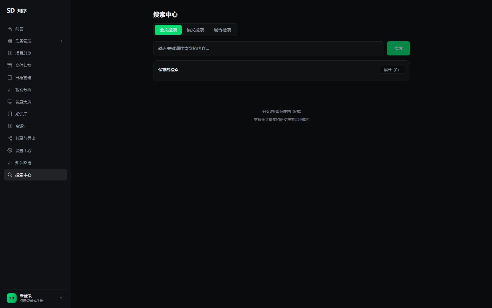 | 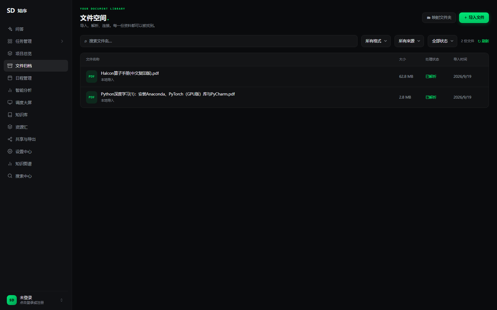 |
| **Analytics** | **Resource hub · GitHub daily trending** |
| 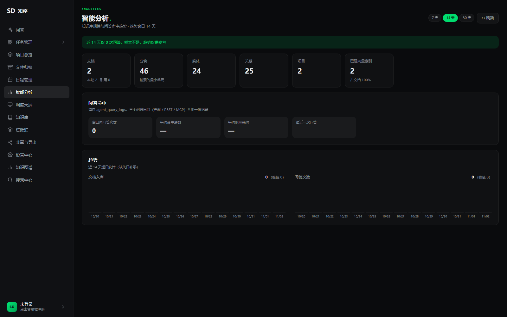 |  |
| **Operations big screen** | **Share & export** |
| 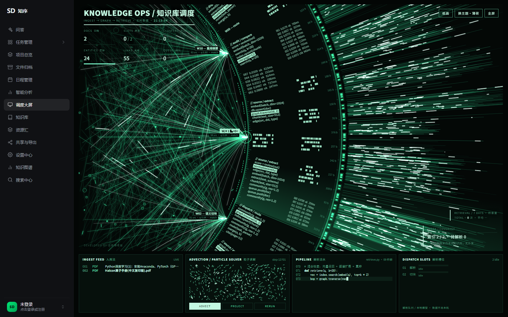 | 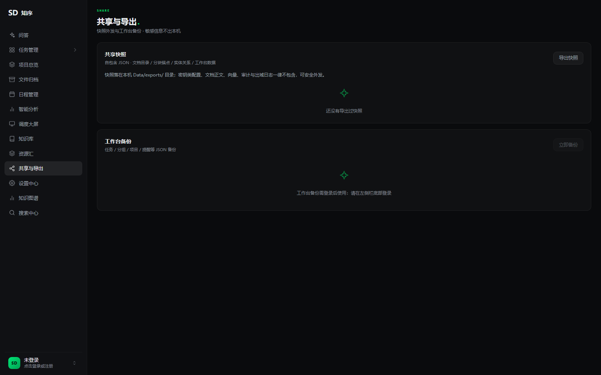 |
| **Settings** | |
| 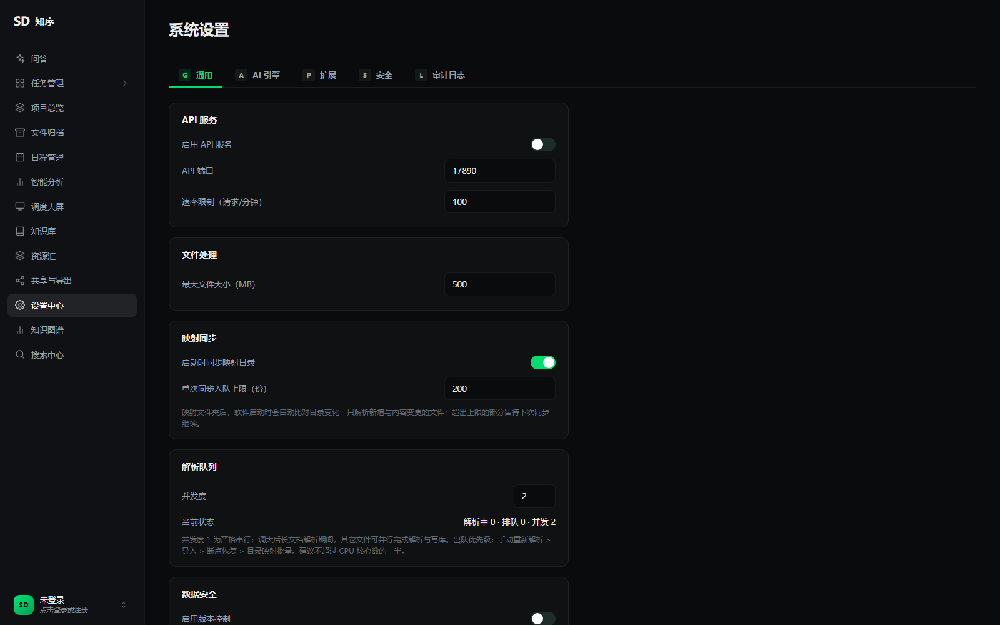 | |

## Architecture

The design is "**three entries + one service layer + one local database**": the three run modes are just different access paths, while all business logic lives in `electron/services/`, so desktop, web and MCP behave identically.

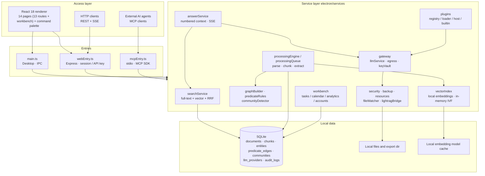

> Note: model capability does not exist on the code path by default — `LlmService` knows no model protocol; a provider can only come from an enabled plugin's `createProvider()`. With nothing configured, the gateway registers `null` and callers degrade to pure retrieval.

### Modules

| Path | Responsibility |
| --- | --- |
| `electron/main.ts` | Desktop entry: window, IPC, desktop-only capabilities |
| `electron/webEntry.ts` | Web entry: `/local/rpc` (session auth), `/local/ask/stream` (SSE), `/api/v1/*` (API key), SPA fallback |
| `electron/mcpEntry.ts` | MCP entry: stdio protocol, 26 tools |
| `electron/services/` | Shared service layer: retrieval, Q&A, parsing, graph, plugins, gateway, workbench, security, backup |
| `electron/services/plugins/` | Four-layer plugin system: registry / loader / host / built-ins |
| `electron/services/gateway/` | LLM gateway: provider abstraction, egress gate, key vault, audit |
| `electron/services/workbench/` | Workbench domain: tasks, projects, calendar, analytics, accounts, RPC dispatch |
| `src/pages/` | Page components: Ask, Search, Graph, Files, Resources, Analytics, Big screen, Share, … |
| `src/workbench/` | Workbench UI and state (`WorkbenchContext`) |
| `src/shortcuts.ts` | Single source of truth for numeric page shortcuts, shared by the command palette and key listener |
| `tests/` | Integration and contract tests plus the retrieval evaluation suite |

### Sidebar navigation

Thirteen entries: `Ask · Workbench · Projects · Files · Calendar · Analytics · Big screen · Knowledge · Resources · Share & Export · Settings · Graph · Search`.

`Ctrl/Cmd + K` opens the command palette; `1`–`9` and `0` are page shortcuts (registered in `src/shortcuts.ts`).

## Core Flows

### 1. Ingestion pipeline

From "drop in a file" to "searchable" takes five steps — parse, chunk, extract, embed, index — executed asynchronously in a queue so the UI never blocks.

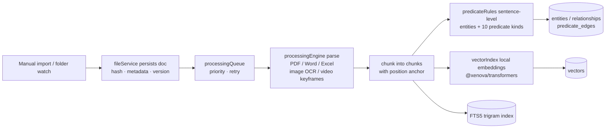

Key points:
- Chunks and indexes are written **idempotently**; rescanning never duplicates rows;
- Folder trees use `(source_id, path)` as a natural key and only prune vanished paths, so id drift cannot orphan edges attached to folders;
- Existing databases are **snapshotted before migration** (new databases skip it).

### 2. Hybrid retrieval and streaming Q&A

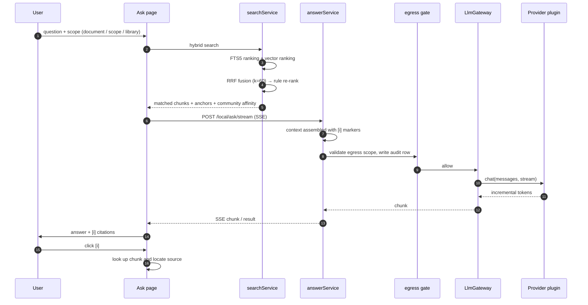

Key points:
- Client disconnect cancels the provider request via `AbortController` — no idle work, no wasted tokens;
- Every question (success or failure) is logged to `agent_query_logs`, which feeds the analytics page;
- Without a configured model this entry degrades as a whole, leaving no dead UI affordance.

### 3. Knowledge graph model

The graph uses **governed predicates + communities** instead of free-text relations, keeping extraction noise bounded.

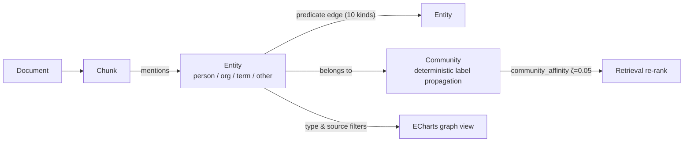

The ten predicates form a closed set: `DEPENDS_ON`, `PART_OF`, `USES`, `IMPLEMENTS`, `REPLACES`, `EXTENDS`, `CITES`, `PRODUCES`, `OWNS`, `LOCATED_IN`. Extraction is **sentence-level**: adjacent entity pairs within the same sentence, a maximum gap of 24 characters, and no cross-sentence guessing. Community detection must be triggered explicitly and writes results into `entity_communities` / `communities`.

### 4. Plugin layers

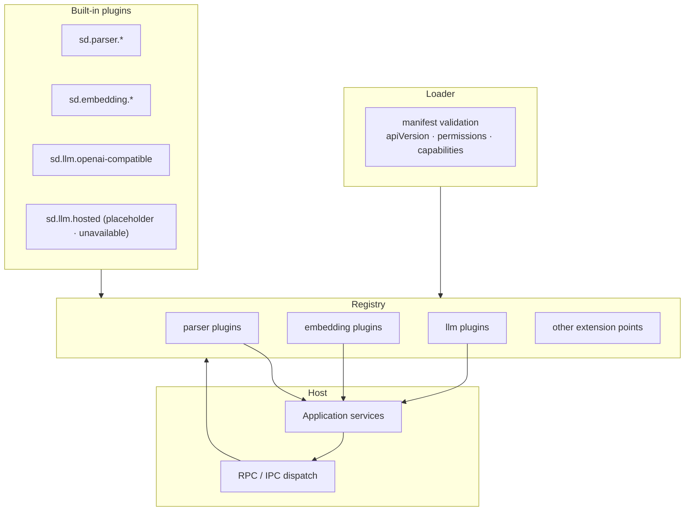

Three invariants:
1. **No plugin, no provider** — `buildProvider` contains no `new XxxProvider` literal;
2. **Registration is not activation** — registering a plugin declares capability only; it creates no config and sends no request;
3. **Disabling means gone** — a disabled plugin's type disappears from the selectable list, saved configs degrade to "not connected", and the main process never crashes.

## Tech Stack

| Layer | Stack |
| --- | --- |
| Desktop shell | Electron 30 (main / preload / renderer isolation) |
| Frontend | React 18.3 · TypeScript 5.4 · Vite 5 · Tailwind CSS · ECharts 5 |
| Backend | Node.js · Express 4 (web-mode API) |
| Database | better-sqlite3 11 (WAL · FTS5 trigram · versioned migrations) |
| Retrieval | FTS5 full-text + `@xenova/transformers` local embeddings (in-memory IVF) + RRF |
| NLP | nodejieba (Chinese) · compromise (English) |
| Parsing | pdfjs-dist · mammoth · xlsx / exceljs · tesseract.js · exifr · fluent-ffmpeg |
| Security | AES-256-GCM key vault · API key auth · audit logs |
| Agent integration | @modelcontextprotocol/sdk 1.x |

## Quick Start

### Prerequisites

- Node.js ≥ 18 (20 LTS recommended)
- Windows 10/11 (primary platform; macOS / Linux on the [roadmap](#roadmap))
- Optional: FFmpeg (video keyframe extraction)

### Up and running in 3 minutes

```bash
# 1. Clone
git clone https://github.com/gqallen931/sd-knowledge.git
cd sd-knowledge

# 2. Install dependencies and rebuild native modules (better-sqlite3 ABI)
npm install
npm run rebuild

# 3. Start dev environment (Vite HMR + Electron)
npm run dev
```

Then import documents in **Files** (or add a folder source) and, once parsing finishes, search in **Search Center**. The **Knowledge dashboard** refreshes document, entity, relation and size statistics.

### Common scripts

| Command | Purpose |
| --- | --- |
| `npm run dev` | Dev mode: Vite + Electron |
| `npm run build` | Type check + frontend build |
| `npm run package:win` | Package the Windows installer (output in `release/`) |
| `npm run start:web` | Start in web mode (build first) |
| `npm run dev:web` | Web dev mode (API on port 5174) |
| `npm run mcp` | Start as an MCP Server |
| `npm test` | Type check + 13 integration/contract tests |
| `npm run eval` | Retrieval evaluation against the baseline |
| `npm run perf:report` | Performance report |

## Installation & Configuration

### Model access (optional, off by default)

Model access is a **plugin extension point**; by default no provider type exists. To enable:

1. Enable a model plugin (e.g. built-in `sd.llm.openai-compatible`) under **Settings → Extensions**;
2. Add a provider row under **Settings → AI Engine**.

| Field | Example | Notes |
| --- | --- | --- |
| Type | `byo-openai` | Values come from **enabled plugins**; disabling the plugin removes the type |
| API Endpoint | `https://api.deepseek.com/v1` | OpenAI-compatible API base URL |
| API Key | `sk-...` | AES-256-GCM encrypted in the main process; invisible to the renderer |
| Model | `deepseek-chat` | Model identifier |
| Egress scope | current document / selected scope / whole library | Minimum scope by default; whole library requires explicit confirmation |

> With no model configured, no outbound request is ever made — guarded by `tests/llm-plugin-seam.cjs`, which asserts zero requests against a watchdog endpoint.

### LightRAG bridge (optional, off by default)

`lightragBridge.ts` is only a **connector**. Its settings and defaults:

```
lightrag_enabled    = false (default)
lightrag_endpoint   = http://127.0.0.1:9621 (loopback root address only)
lightrag_timeout_ms = 5000
```

State values are `disabled` / `ready` / `unavailable` / `misconfigured`. The bridge starts and manages no external process; it only probes status read-only. Endpoints with userinfo, path, query or a non-loopback host are treated as `misconfigured`.

### Data locations

- Business database: a single local SQLite file (app data directory, WAL)
- Shared snapshots: `Data/exports/` (self-contained JSON, secrets and sensitive fields stripped)
- Embedding model: downloaded on first use and cached locally

## Usage Guide

<details>
<summary><b>Flow 1: Import documents and index them</b></summary>

1. Open **Files**, then click "Import files" or "Map folder";
2. Parsing tasks enter the queue; concurrency is configurable under **Settings → General → Parsing queue** (1–32, default 2);
3. Once parsed, open **Search Center** and compare the three modes: full-text / semantic / hybrid;
4. Check **Knowledge dashboard** for totals of documents, entities, relations and size.
</details>

<details>
<summary><b>Flow 2: Ask a question and get cited answers</b></summary>

1. Open **Ask**, type a question and choose a scope (current document / selected scope / whole library);
2. The system runs hybrid retrieval, numbers the matched chunks as `[i]`, then streams a grounded answer;
3. Every citation in the answer is clickable and jumps to the source chunk;
4. When the corpus is insufficient, it returns "no relevant content found" instead of guessing.
</details>

<details>
<summary><b>Flow 3: Curate the knowledge graph</b></summary>

1. Open **Graph** and filter by node type (document / entity / term) and data source (local import / external reference);
2. Click a space node to drill down into that space's entity layer;
3. Switch between force-directed and circular layouts; use "batch merge" and "suggestions" to resolve synonyms;
4. Renames and merges are recorded as aliases and merge history, visible in the graph panel.
</details>

<details>
<summary><b>Flow 4: Connect AI agents via MCP</b></summary>

```bash
# Start as an MCP Server (build first)
npm run mcp
```

Register the server in an MCP-capable client and the agent can call 26 tools: 15 in the knowledge domain (`search`, `semantic_search`, `get_context`, `ask`, `list_documents`, `get_document`, `get_graph_stats`, `get_entities`, `get_entity_graph`, `find_connections`, `search_entities`, `rename_entity`, `merge_entities`, …) and 11 in the workbench domain (`workbench_overview`, `list_tasks`, `create_task`, `update_task`, `complete_task`, `get_timeline`, `search_all`, …).
</details>

<details>
<summary><b>Flow 5: Export a shareable snapshot</b></summary>

1. Open **Share & Export** and click "Export snapshot";
2. The self-contained JSON contains documents, chunks, entities/relations and workbench data only;
3. **Keys, sensitive plaintext fields, vectors, audit logs and egress logs are excluded**, so it is safe to share.
</details>

## Run Modes

| Mode | Command | Auth | Use case |
| --- | --- | --- | --- |
| Desktop | `npm run dev` / `npm run start:desktop` | In-process IPC | Single-machine, all capabilities |
| Web | `npm run dev:web` / `npm run start:web` | `/local/*` via session (`X-SD-Session`); `/api/v1/*` via API key | LAN access from multiple devices, scripting |
| MCP | `npm run mcp` | Process-level stdio | External AI agents over knowledge and workbench |

## Project Structure

```
sd-knowledge/
├── electron/                    # Main process
│   ├── main.ts                  # Desktop entry (IPC)
│   ├── webEntry.ts              # Web entry (Express / SSE / API key)
│   ├── mcpEntry.ts              # MCP Server entry (stdio)
│   └── services/                # Shared service layer
│       ├── database.ts          # SQLite connection, indexes, FTS5, defaults
│       ├── coreMigrations.ts    # Versioned migrations v1–v9
│       ├── searchService.ts     # Full-text / semantic / RRF hybrid search
│       ├── answerService.ts     # Numbered context, streaming Q&A, citations
│       ├── processingEngine.ts  # Parsing pipeline
│       ├── processingQueue.ts   # Parse queue (concurrency, retry, priority)
│       ├── vectorIndex.ts       # Local vector index (in-memory IVF)
│       ├── graphBuilder.ts      # Graph construction and entity governance
│       ├── predicateRules.ts    # Extraction rules for 10 governed predicates
│       ├── communityDetector.ts # Deterministic label-propagation communities
│       ├── lightragBridge.ts    # LightRAG read-only connector (off by default)
│       ├── mcpServer.ts         # 26 MCP tools
│       ├── gateway/             # LLM gateway: provider / egress / keyVault
│       ├── plugins/             # Plugin system: registry / loader / host / builtin
│       └── workbench/           # Tasks, projects, calendar, analytics, accounts
├── src/                         # Renderer (React)
│   ├── pages/                   # 13 page components
│   ├── workbench/               # Workbench UI and state
│   ├── components/              # Sidebar, command palette, …
│   └── shortcuts.ts             # Shortcut registry
├── tests/                       # Integration / contract tests + eval/
├── docs/assets/                 # README screenshots
└── resources/                   # Icons and packaging assets
```

## Data Model & Migrations

All schema changes go through **versioned migrations** (`coreMigrations.ts` + `workbench/schema.ts`); existing databases are snapshotted before migrating.

| Version | Migration | Key content |
| --- | --- | --- |
| v1 | `baseline-document-and-queue-columns` | Document and queue column baseline |
| v2 | `chunks-and-vector-chunk-link` | `chunks` table; vectors linked to chunks |
| v3 | `llm-providers-and-egress-logs` | `llm_providers`, `llm_egress_logs` |
| v4 | `llm-egress-scope-and-host-columns` | Egress scope mode and target host |
| v5 | `resources-open-source-hub` | Open-source resource hub |
| v6 | `github-daily-rank` | GitHub daily trending snapshots |
| v7 | `saved-searches` | Saved searches (result hash, last run) |
| v8 | `entity-aliases-and-merge-history` | Entity aliases, merge history, ignores |
| v9 | `predicate-edges-and-entity-communities` | Predicate edges, entity communities, community stats |

## Testing & Quality

`npm test` first type-checks both sides (renderer and main process), then runs 13 test scripts:

| Test | Coverage |
| --- | --- |
| `lightrag-bridge.cjs` | Endpoint normalization, `disabled` default, non-loopback rejection |
| `llm-gateway.cjs` | Provider lifecycle, error grading, egress gate |
| `llm-plugin-seam.cjs` | Model-as-plugin seam: zero-request assertion, disable degradation |
| `integration.cjs` | End-to-end: import → parse → retrieve → graph |
| `predicate-graph.cjs` | 10 predicate kinds and community detection |
| `auth-flow.cjs` / `auth-web.cjs` | Account signup / login / session and web auth |
| `saved-search.cjs` / `entity-alias.cjs` | Saved searches, entity aliases and merges |
| `analytics-logs.cjs` / `audit-retention.cjs` | Analytics aggregation, audit retention and pruning |
| `schedule.cjs` / `export-snapshot.cjs` | Calendar computation, snapshot field stripping |

Also:

- `npm run eval`: retrieval evaluation with baseline diffing, guarding against quality regressions;
- `npm run perf:report` / `npm run perf:threads`: retrieval and embedding performance reports.

## Security & Privacy

- **Local-first**: business data stays in local SQLite — no cloud sync, no telemetry;
- **Key isolation**: model keys are AES-256-GCM encrypted and only exist in the main process;
- **Egress gate**: three egress scopes; whole-library requires explicit double confirmation; each call writes an audit row (time / provider / host / scope mode / chunk and character counts / document and chunk ids);
- **Layered auth**: web `/local/*` requires a session; `/api/v1/*` requires an API key with role and scopes;
- **Audit retention**: retention days are configurable and logs can be pruned;
- **Fault isolation**: plugin load or runtime failures stay contained; the host is unaffected;
- **Graded errors**: unified error codes; no SQL statements or absolute paths leak out.

## Design Docs

Key architectural decisions are recorded as ADRs (maintained in the workspace documentation library):

| Document | Topic |
| --- | --- |
| ADR-001 | FTS5 trigram full-text search for Chinese |
| ADR-002 | Scoped graph and daily-loop design |
| ADR-003 | DeskForge fusion plan |
| ADR-004 | LLM access strategy and key isolation |
| ADR-005 | Plugin architecture (registry / loader / host / built-ins) |
| ADR-006 | Model access as a plugin extension point (off by default) |
| ADR-007 | Governed predicate graph and community detection |

## Roadmap

- [x] **S0 · Local foundation** — multi-format parsing · FTS5 + vector RRF hybrid search · chunk traceability · folder mapping
- [x] **S1 · Q&A loop** — LLM gateway · egress gate and audit · SSE streaming · citation lookup · retrieval eval baseline
- [x] **S2 · Platform** — plugin system · accounts · workbench / calendar / analytics · messages and share/export · big screen · saved searches · entity aliases and merges
- [x] **Graph depth** — governed predicate edges · sentence-level extraction · deterministic community detection (migration v9) · model access as a plugin (ADR-006)
- [ ] **Packaging** — Windows installer signing and auto-update (`S2-11`)
- [ ] **Cross-platform** — macOS / Linux builds
- [ ] **More extension points** — new parser / embedding plugins · optional LightRAG engine · full open-sourcing of design docs

## Contributing

Issues and Pull Requests are welcome. Before submitting a PR, please ensure:

1. `npm run typecheck` passes (renderer and main process);
2. `npm test` passes;
3. For retrieval or ranking changes, run `npm run eval` to confirm no baseline regression;
4. For schema changes, add a new migration instead of editing an old one, and update the tests;
5. Commit messages follow Conventional Commits (`feat:` / `fix:` / `docs:` / `refactor:` / `test:`).

## License

Released under the [MIT License](./LICENSE) — free for personal and commercial use.

## Contact

- **Bug reports & feature requests**: [GitHub Issues](https://github.com/gqallen931/sd-knowledge/issues)
- **Discussions**: [GitHub Discussions](https://github.com/gqallen931/sd-knowledge/discussions)

---

<div align="center">

If this project helps you, please consider giving it a ⭐ Star

</div>
